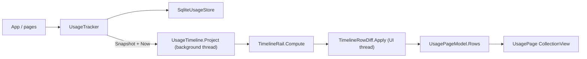

# Usage

A local, append-only log of how the app is used, and the page that shows it as a timeline.

## What it records

Each row in the log is an immutable `UsageEvent` with a `Kind` (`UsageEventKind`), a UTC
timestamp, a store-assigned `Sequence`, and optional context: `SessionId`, `PageVisitId`,
`Name`, `Route`, durations, window size, and a `ParentId` for nested interactions.

| Kind | Meaning |
| --- | --- |
| `Installed`, `Updated`, `HistoryReset` | Root markers. The newest one is the bottom of the timeline. |
| `SessionStarted`, `SessionEnded` | One process lifetime. `EndReason` is `Clean` or `Terminated`. |
| `PageOpened`, `PageClosed` | One visit to a page. The close carries `Elapsed` and `Active`. |
| `Backgrounded`, `Foregrounded` | The window lost or regained the foreground inside a visit. |
| `AreaChanged` | Window size changed; `Mode` comes from `UsageArea.Classify`. |
| `ControlPressed`, `SurfaceOpened`, `SelectionMade` | A button, the menu it opened, and the choice made. |
| `PermissionRequested` | A permission prompt and its result. |

Events go through `IUsageStore`. `SqliteUsageStore` writes them to `usage.db` in the app data
directory and assigns `Sequence`. `UsageTracker` keeps the full list in memory once loaded, so
reads never touch the database after startup.

## How events get in

`UsageTracker` is a singleton (see `MauiProgram`). It is the only writer.

- `App` wires window and shell signals: `Activate` on activated or resumed, `Background` on
  deactivated or stopped, `EndSession` on destroying, `Navigate` on shell navigation, `NoteArea`
  on size change, and `NoteRelease` with the version from `PlatformInstall`.
- Pages and controls reach the tracker through `UsageServices.Current` for `BeginInteraction`,
  `NoteChoice`, `CompleteInteraction`, and `RecordPermission`.
- `UsagePage` also calls `Navigate` for itself in `OnAppearing`. Shell raises `Navigated` only
  after the page has appeared, which would otherwise add the page's own row after the list is
  on screen. `Navigate` ignores a page that is already open, so the later call is a no-op.

Rules the tracker enforces:

- A session stays open across backgrounding. Coming back is a `Foregrounded` event, not a new
  session. A new session starts only on the first `Activate` of a process.
- A page visit records elapsed time and foreground-only active time. `UsageMath.ActiveTime`
  sums the foreground slices between background and foreground events.
- If the process was killed, the next launch finds the open session and closes it as
  `Terminated` at the last background time, closing its open page too (`ReconcileOrphans`).
- Toolkit popups are ignored as pages so they do not interrupt the visit underneath.
- `Reset` clears the store, writes a `HistoryReset` root, and starts a fresh session on the
  current page.

Every change raises `Changed`.

## How the page is built

- `UsageTimeline.Project` turns the event list into `TimelineRow`s. Events are sorted once and
  grouped by session in a single pass. Each session becomes a block, newest first, ordered by
  its most recent event; `Updated` events are blocks of their own; the root goes last. Row
  depth encodes nesting: session 0, page 1, activity 2, menu 3, selection 4.
- `TimelineRail.Compute` works out the connector lines beside each row with two linear sweeps,
  one down and one up. `UsageRailView` draws the result with `GraphicsView`.
- `UsagePageModel` owns the refresh loop. Each time the page appears it projects inline and
  replaces `Rows` with a fresh collection, so the list draws current in one reset instead of
  animating in everything that happened since the last visit. While visible it runs a
  one-second clock and listens to `Changed`. Each request takes `UsageTracker.Snapshot()` and
  `Now`, projects on a background task, and applies the result on the UI thread. Overlapping
  requests collapse: at most one projection runs at a time, with one follow-up if anything
  arrived meanwhile.
- `TimelineRowDiff.Apply` patches the bound `ObservableCollection` by row `Id`: remove rows that
  disappeared, insert or move rows that appeared or shifted, and update `Detail` and `Rail` on
  rows that stayed. It replaces the collection wholesale when nothing survives (after a reset),
  so the list raises one reset instead of one event per row.
- Rows are a fixed 44pt and the `CollectionView` uses `MeasureFirstItem`. Self-sizing cells laid
  out from an estimate and then grew to size during the Shell transition, which showed as rows
  squeezing and spreading. Labels truncate rather than wrap so the fixed height never clips.
- The row template binds `Title`, `When`, indent, and colour once per cell (`Mode=OneTime`).
  `Detail` and `Rail` bind normally because they change while a row is visible. Colours come
  from `UsageColors` through `CategoryColorConverter`; a theme change rebuilds the cells via
  `UsagePageModel.RebuildCells`.

## Tests

`MauiLabTests` covers the tracker rules (`UsageTrackerTests`), the store, the area classifier,
and the rail geometry. `LegacyTimeline` is the previous, quadratic projection kept as an
oracle: `UsageTimelineTests` drives the real tracker through thousands of generated events and
checks the linear projection produces identical rows. `TimelineRowDiffTests` covers insert,
remove, move, replace, and silent no-op updates.
